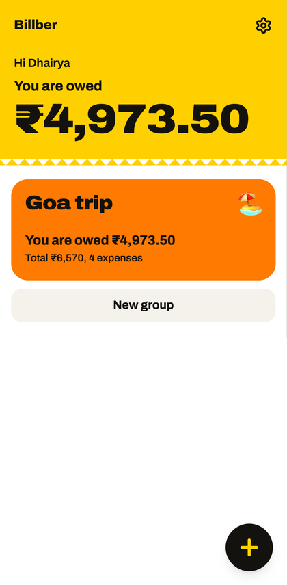
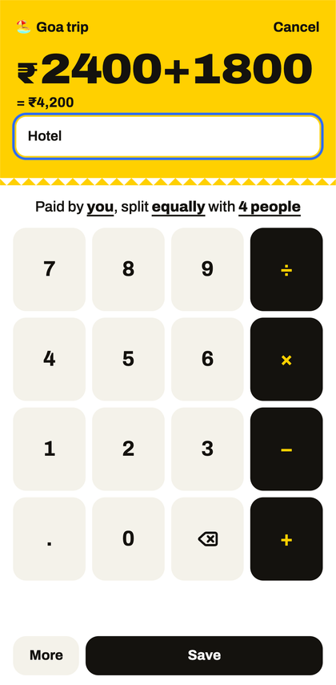
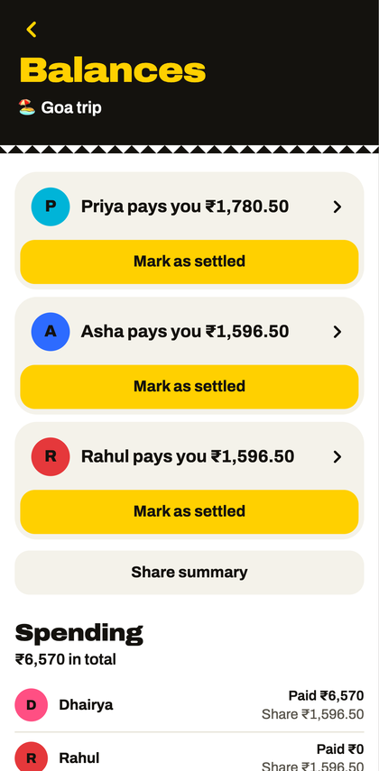

<div align="center">

# Billber

**Split shared expenses in three taps. No account, no server, works offline.**





</div>

Most expense apps start with a long form. Billber starts with the amount. Payer, split, date and category all have sensible defaults, so an equal split takes three taps: **+**, the amount, **Save**.

The app runs entirely in the browser. Your data stays on your phone, and friends don't need to install anything: you send them a summary or a read-only link.

## What it does

- **Fast entry:** a keypad that does maths (`450+120`), and a sentence you can tap to change who paid, how it's split, and who's in.
- **Every split:** equal, exact amounts, percentages and shares, plus multiple payers. Save stays locked until the numbers add up.
- **Fewest payments:** balances are simplified into the shortest list of who pays whom, in plain words such as "Rahul pays you ₹450".
- **Show your working:** tap any balance to see the expenses behind it.
- **Mark as settled:** record a full or partial payback. Billber never moves money.
- **Undo:** 10 seconds to undo an add, edit, delete or settlement, plus a full history for each group.
- **Sharing without a server:** a text summary for WhatsApp, or a read-only link with the group packed inside the link itself.
- **Your data is yours:** export everything to a JSON file and import it on a new phone.
- **Offline and installable:** a PWA that works with no internet.

## How the money stays right

All the money logic lives in one pure module, [src/money.ts](src/money.ts), with no UI or storage code.

- **Integer paise only.** ₹450.50 is stored as `45050`, and fractions are calculated with `BigInt`, so a float can never round a balance.
- **No lost paise.** ₹1,000 split three ways becomes ₹333.33, ₹333.33 and ₹333.34. Leftover paise go to the largest remainders, and ties break on person id, so the result never depends on list order.
- **Balances are derived, never stored.** They're always recalculated from expenses and settlements, so they can't drift. The nets in a group must add up to exactly zero, and the code throws if they don't.
- **Fewest payments.** The biggest debtor is matched with the biggest creditor, which needs at most n − 1 payments.

Property-based tests run these rules against thousands of random groups: splits always equal the amount, nets always sum to zero, and simplified payments always clear everyone.

## Run it

Requires Node 20.19 or newer.

```bash
npm install
npm run dev        # http://localhost:5173
```

```bash
npm test           # unit and property tests
npm run build      # typecheck and production build
npm run e2e        # browser tests, needs Chrome and a fresh build
```

## Deploy for free

Billber is a static site. On [Cloudflare Pages](https://pages.cloudflare.com/), connect this repo and use:

| Setting | Value |
| --- | --- |
| Build command | `npm run build` |
| Output directory | `dist` |

The free plan allows commercial use and has unlimited static bandwidth.

## Project layout

```text
src/
  money.ts       pure split, balance and simplify logic
  db.ts          IndexedDB schema (Dexie)
  repo.ts        the only module that touches storage
  share.ts       text summaries, share links, backup files
  schema.ts      validation for imported data (Zod)
  screens/       Home, Group, Balances, SharedView, Settings, Setup
  components/    AddExpenseSheet, SplitEditor, ShareSheet and shared UI
e2e/             Playwright tests
```

Screens only read and write through `repo.ts`, so adding a backend later means changing that one file.

## Limits

- Data lives on one device, so one person keeps the group up to date. Export a backup regularly, because clearing browser data deletes it.
- A shared link is a snapshot. It shows the date it was made, so re-share it after changes.
- Links fit groups of about 100 expenses or more, depending on the data. Bigger groups share a file instead.
- Anyone who has a share link can read the names and amounts inside it.

## License

MIT
